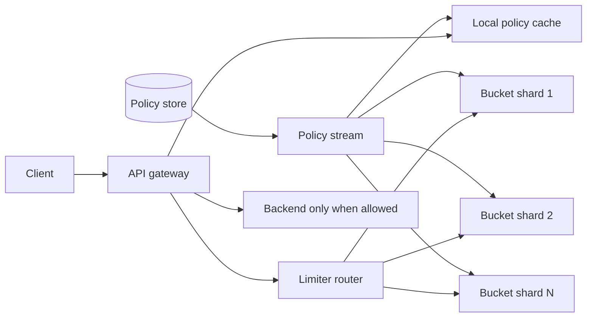

# Case study: design a distributed API rate limiter

**Difficulty:** Foundational

**Primary muscles:** atomic counters, token bucket, partitioning, bounded
approximation, configuration rollout, and failure policy.

## 1. Scope and requirements

Build a limiter used by API gateways before requests reach backend services.
Policies can apply to a tenant, API credential, user, IP address, endpoint, or
a hierarchy of these dimensions.

Assume:

- Gateways receive 1 million requests per second globally at peak.
- There are 100,000 tenants and up to 10 million active limit keys.
- A decision should add less than 5 ms p99 latency within a region.
- Policies support a sustained rate plus a bounded burst.
- Policy updates should take effect within one minute.
- Small, bounded overshoot is acceptable for normal API traffic.
- Security-sensitive endpoints may fail closed; ordinary reads should degrade
  with a conservative local limit if the limiter is unavailable.
- Monthly billing quotas are out of scope; they need durable usage accounting,
  not only an in-memory rate limiter.

One remote operation per request means the decision path must sustain the full
1 million RPS. At roughly 100 bytes per active bucket, 10 million buckets use
about 1 GB before allocator overhead and replicas, so state fits in memory but
must be sharded for throughput.

## 2. Policy and decision contract

The gateway calls an internal decision API:

```text
allow(
  subject_key,
  route_key,
  request_cost,
  request_deadline,
  policy_version
) -> {
  allowed,
  remaining,
  retry_after,
  decision_source
}
```

Core records:

```text
Policy(policy_id, scope, route_pattern, rate_per_second, burst, mode, version)
Bucket(bucket_key, policy_version, tokens, last_refill_time)
```

Policies live in a durable configuration store. Gateways and limiter nodes
watch a versioned policy stream and keep local caches. Bucket state is
ephemeral operational state; policy is not.

## 3. Algorithm

Use a token bucket. A bucket with capacity `B` permits a burst of `B` tokens and
refills at `R` tokens per second.

For each decision, one authoritative shard atomically:

1. Loads the token count and last refill time.
2. Adds `elapsed_time x R`, capped at `B`.
3. If enough tokens remain, subtracts the request cost and allows it.
4. Otherwise rejects it and calculates when enough tokens will exist.
5. Stores the new count and refill time.

The shard uses its own monotonic time source for the atomic operation rather
than trusting gateway clocks.

## 4. High-level design



Hash the full bucket key to one owner so all updates for that limit are
serialized. Use consistent or rendezvous hashing to reduce movement during
membership changes. Replicate shard state if preserving current budgets across
node failure matters; otherwise a failed shard may conservatively restart
empty or accept a bounded reset according to policy.

## 5. Hierarchical limits

A request may need to satisfy several policies:

- Global service protection.
- Per-tenant fairness.
- Per-user or credential limits.
- Per-endpoint cost controls.

Checking a single global bucket at 1 million RPS would create a hot key. Instead,
the global controller leases token blocks to regional or gateway-local buckets.
Each local bucket spends its allowance without a remote global write. The
maximum overshoot is bounded by outstanding leases.

Evaluate narrower keys on their owner shards. For all-or-nothing multi-policy
decisions, route related buckets together where possible or reserve tokens in a
defined order and refund partial reservations. Many products accept a
conservative approximation rather than a distributed transaction on every
request.

## 6. Gateway behavior

On allow:

- Forward the request.
- Optionally return standard rate-limit headers with the policy window and
  remaining estimate.

On reject:

- Return HTTP `429`.
- Include `Retry-After` when the retry time is meaningful.
- Do not automatically queue arbitrary client requests; that moves overload
  into gateway memory.

The client-provided identity is not trusted. Derive tenant and user keys from
authenticated credentials. IP limits are a secondary abuse signal because NAT
can group many legitimate users.

## 7. Configuration rollout

Every policy has an immutable version. The control plane validates overlapping
rules, publishes a new version, and reports propagation status. Decision logs
include the matched policy and version.

When a rate changes, a bucket can:

- Preserve its current token ratio against the new capacity.
- Clamp tokens to the new burst limit.
- Reset according to an explicit policy for emergency blocking.

This avoids accidental bursts when configuration changes.

## 8. Failures and overload

| Scenario | Behavior |
| --- | --- |
| One limiter shard fails | Route to a replica or apply the policy's explicit local emergency mode. |
| The policy stream is delayed | Continue with the last valid version, expose version age, and alert after the one-minute SLO. |
| A gateway cannot reach the limiter | Fail closed for expensive mutations; use a conservative local bucket for low-risk reads. |
| One tenant is extremely hot | Its key remains isolated to a shard; split sublimits or lease tenant tokens to gateways if that shard saturates. |
| Membership changes | Move ownership gradually; version routing metadata so only one owner authorizes a bucket at a time. |
| Gateways retry decisions | Give each request a short-lived decision ID only if duplicate charging materially affects policy. |
| The whole service is overloaded | Load shedding based on backend saturation can reject traffic even when a user's rate bucket has tokens. |

Rate limiting enforces fairness and quotas. It cannot replace concurrency
limits, queue bounds, or load shedding based on actual backend health.

## 9. Trade-offs and interviewer follow-ups

One authoritative owner per bucket provides straightforward atomicity but adds
a network hop. Local token leases lower latency and remove hot global keys at
the cost of bounded overshoot. The failure mode varies by policy instead of
pretending fail-open or fail-closed is universally correct.

Likely follow-ups:

- How would you enforce a strict monthly quota?
- How do you limit concurrent long-running requests rather than request rate?
- How would policies work across multiple regions?
- How would you test that a rollout never doubles the effective allowance?

Patterns used:

- [Rate limiting](../patterns/rate-limiting.md)
- [Partitioning and consistent hashing](../patterns/partitioning.md)
- [Replication](../patterns/replication.md)
- [Resilience patterns](../patterns/resilience.md)
- [Load balancing and edge delivery](../patterns/traffic-management.md)
