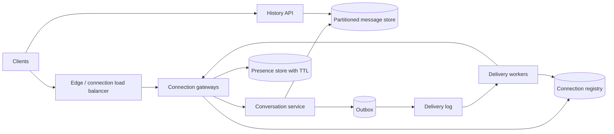

# Case study: design a realtime chat system

**Difficulty:** Intermediate

**Primary muscles:** persistent connections, per-conversation ordering,
multi-device delivery, offline synchronization, and presence.

## 1. Scope and requirements

Support one-to-one conversations and groups of up to 500 members. Users can
send text messages, receive them on multiple devices, fetch history, and see
delivered and read status.

Assume:

- 50 million daily active users and 5 million simultaneous connections.
- 1 billion messages per day, about 12,000 average messages/second and 120,000
  at peak.
- Average stored message size is 1 KB before indexes and replicas.
- Online delivery should normally occur within 500 ms.
- Message history is retained for one year.
- Messages from one conversation must have a stable server order.
- Presence may be approximate and up to one minute stale.
- A message acknowledged as accepted must survive an availability-zone failure.

End-to-end encryption, voice/video calls, public channels with millions of
members, and message search are separate deep dives.

At 1 KB per message, content grows by about 1 TB per day before replication.
Five million sockets require a dedicated connection tier; if one gateway holds
50,000 connections, at least 100 gateways are needed before redundancy and
headroom. A 60-second heartbeat produces roughly 83,000 heartbeat events/second.

## 2. Protocol and data model

Clients use WebSocket or another bidirectional protocol for live traffic and
HTTP for bootstrap or large history pages.

```text
SEND_MESSAGE {
  conversation_id,
  client_message_id,
  body,
  attachment_refs
}

MESSAGE_ACCEPTED {client_message_id, message_id, sequence_no}
MESSAGE_DELIVERED {conversation_id, through_sequence_no, device_id}
MESSAGE_READ {conversation_id, through_sequence_no, user_id}
```

Core records:

```text
Conversation(conversation_id, home_region, type, membership_version)
Participant(conversation_id, user_id, joined_sequence, left_sequence, role)
Message(conversation_id, sequence_no, message_id, sender_id, body_ref, created_at)
DeviceCursor(user_id, device_id, conversation_id, delivered_through, read_through)
```

Partition messages by `conversation_id` and order by `sequence_no`. Store large
attachments in object storage after a separate validated upload. A uniqueness
constraint on `(sender_id, client_message_id)` makes client retries idempotent.

## 3. High-level design



Connection gateways authenticate sessions, maintain sockets, apply per-device
backpressure, and route commands. They do not own durable message state.

## 4. Send path and ordering

1. A client sends a stable `client_message_id`.
2. The gateway authenticates the user and checks current conversation
   membership.
3. It routes the command by `conversation_id` to that conversation's home
   partition.
4. One logical writer for the partition validates the membership version,
   assigns the next sequence number, and atomically stores the message,
   idempotency mapping, and outbox event.
5. The service acknowledges `MESSAGE_ACCEPTED` only after the write is durably
   replicated.
6. Delivery workers consume the event and route it to online devices.

The sequence number defines server order, not the sender's wall clock. Messages
sent concurrently from different regions may appear in either order, but every
client eventually observes the same order for that conversation.

Optimistic concurrency or a partition-owned sequencer prevents two messages
from receiving the same sequence. A single conversation's write throughput is
bounded by one ordering stream, which is acceptable for groups capped at 500.
Massive broadcast channels need a separate design.

## 5. Online and offline delivery

The connection registry maps `(user_id, device_id)` to a gateway and connection
epoch. It is ephemeral and rebuilt as devices reconnect.

For each message:

- Push to every currently connected recipient device.
- Keep the durable message as the source of truth; do not create one full
  message copy per device.
- Let clients advance a cumulative delivered cursor after persistence on the
  device.
- Let read receipts advance a cumulative read cursor, reducing one receipt per
  message to one monotonic update.
- On reconnect, fetch messages after the device cursor in bounded pages, then
  switch to the live stream without leaving a gap.

The bootstrap protocol records a high-water sequence, reads history through
that point, and buffers or subsequently reads newer messages. This prevents a
message from falling between history and live subscription.

## 6. Presence

Gateways refresh a TTL-based presence record while a device is connected.
Aggregate many device records into user-level states such as online or last
seen. Presence is intentionally eventually consistent:

- A gateway crash leaves a user online until TTL expiry.
- Rapid reconnects can reorder presence events.
- Privacy settings may hide exact status.

Do not put presence updates through the durable message path; their volume and
consistency needs differ.

## 7. Multi-region behavior

Assign each conversation a home region and route sends there to preserve one
ordering authority. Gateways can terminate connections near users, but a send
may cross regions to the conversation home.

Replicate message history asynchronously to other regions for disaster
recovery. A region failover must promote a known sequence position and use a
new writer epoch so the former home cannot resume stale writes. The stated
requirements may accept temporary send unavailability rather than conflicting
conversation histories.

## 8. Failures and overload

| Scenario | Behavior |
| --- | --- |
| A connection gateway fails | Clients reconnect through another gateway and resume from durable device cursors. |
| The client retries after losing an acknowledgment | The idempotency mapping returns the original message ID and sequence. |
| A delivery worker repeats an event | Devices deduplicate by message ID or sequence; cursors only move forward. |
| A recipient is slow | Bound each socket buffer, disconnect persistently slow clients, and let them resynchronize from history. |
| The conversation writer fails | Elect or route to a replica with a higher writer epoch and continue after the last committed sequence. |
| One group becomes extremely active | Enforce group-size and message-rate limits or move public broadcast to a fan-out-on-read design. |
| Presence storage fails | Messaging continues; presence degrades to unknown until TTL state recovers. |

Monitor connected sockets, reconnect rate, send acknowledgment latency,
delivery lag, slow-client disconnects, sequence conflicts, message-store
saturation, and history-sync latency.

## 9. Trade-offs and interviewer follow-ups

A home partition gives each conversation a simple total order but adds
cross-region latency and a per-conversation throughput ceiling. Durable history
plus ephemeral delivery avoids copying messages for offline devices, while
cursors make reconnects reliable.

Likely follow-ups:

- How would end-to-end encryption change storage and multi-device sync?
- How would message edits and deletes preserve ordering?
- How would a group with one million members work?
- How would unread counts be maintained efficiently?

Patterns used:

- [Load balancing and edge delivery](../patterns/traffic-management.md)
- [Partitioning](../patterns/partitioning.md)
- [Replication](../patterns/replication.md)
- [Transactional outbox](../patterns/outbox-and-cdc.md)
- [Messaging](../patterns/messaging.md)
- [Idempotency](../patterns/idempotency.md)
- [Leader election and fencing](../patterns/leader-election.md)
