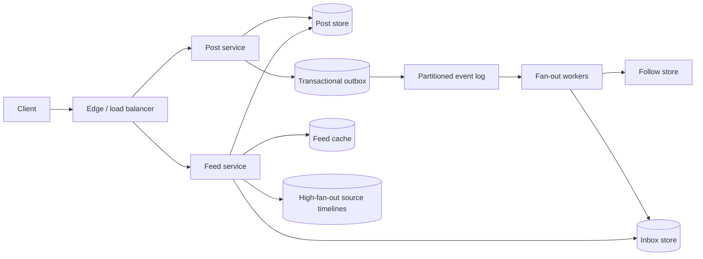

# Case study: design a home news feed

This example demonstrates an interview answer, not a universal production
architecture. Different requirements should produce a different design.

**Difficulty:** Advanced

**Primary muscles:** fan-out, materialized views, skewed workloads,
partitioning, and eventual consistency.

## 1. Scope and requirements

Users can publish short posts, follow or unfollow accounts, and read a
reverse-chronological home feed.

Assume:

- 100 million daily active users.
- 5 million new posts per day, about 60 average writes/second and 600 at peak.
- 2 billion feed reads per day, about 23,000 average reads/second and 230,000 at
  peak.
- A typical user follows 300 accounts.
- Feed reads target p99 under 300 ms.
- New posts may take up to five seconds to appear.
- A user's own post should be visible immediately on their profile.
- Posts and follow edges must survive an availability-zone failure.

The read/write imbalance and latency target justify a materialized home feed.
Follower-count skew requires a hybrid rather than pure fan-out-on-write design.

## 2. API and data model

```http
POST /v1/posts
GET  /v1/users/{user_id}/feed?cursor=...
PUT  /v1/users/{user_id}/following/{followee_id}
DELETE /v1/users/{user_id}/following/{followee_id}
```

Core records:

```text
Post(post_id, author_id, body_ref, created_at, version, visibility)
Follow(follower_id, followee_id, created_at)
Inbox(user_id, rank_time, post_id, source_id)
```

Partition posts by `author_id` or a distributed `post_id`, follow edges by
`follower_id` for feed generation, and inbox entries by `user_id` for one-user
page reads. Use `(user_id, rank_time, post_id)` as a stable cursor.

## 3. High-level design



## 4. Write path

1. The post service authenticates the author and validates content.
2. It writes the post and an outbox event in one transaction.
3. The response returns after the durable post commit; fan-out remains
   asynchronous.
4. CDC or an outbox relay publishes `PostCreated`, partitioned by author ID.
5. Fan-out workers query follower IDs in bounded pages.
6. For ordinary authors, workers idempotently append a post reference to each
   follower's inbox.
7. For high-fan-out authors, workers update one source timeline instead of
   millions of inboxes.

The event ID plus recipient ID forms a uniqueness key, so retries do not create
duplicate inbox entries.

## 5. Read path

1. The feed service checks a short-lived cache for the requested cursor page.
2. On a miss, it reads precomputed inbox entries.
3. It also reads recent candidates from high-fan-out sources the user follows.
4. It merges candidates by `(created_at, post_id)`, applies visibility and block
   rules, and selects a page.
5. It batch-fetches post bodies from the post store or object cache.
6. It returns an opaque cursor containing the last stable sort key.

Caching full personalized feeds has a low hit rate for some products. Cache hot
first pages, post objects, and source timelines independently, then measure.

## 6. Consistency and product changes

- A profile read goes to the post store and provides immediate visibility.
- Home feeds can lag by five seconds; show a processing state only if users need
  stronger feedback.
- A delete or privacy change publishes a high-priority event that removes or
  filters references. Read-time authorization remains the safety net while
  cleanup propagates.
- Follow starts can include only new posts, or backfill a bounded history. The
  product decision changes write cost.
- Unfollow should filter the source immediately at read time, then clean old
  inbox entries asynchronously.

## 7. Failures and overload

| Failure | Response |
| --- | --- |
| Fan-out workers stop | Posts remain durable; queue age rises; autoscale or recover workers before the five-second SLO is exhausted. |
| Duplicate events | Inbox uniqueness key makes insertion idempotent. |
| One author becomes extremely hot | Switch that author to fan-out on read and cache the source timeline. |
| Feed cache fails | Bound database concurrency and serve a smaller page or temporarily omit ranking features. |
| One inbox partition is hot | Split or salt that user's materialization and merge a bounded number of subpartitions. |
| Event log retention is at risk | Alert on oldest unprocessed event and preserve enough retention for catch-up. |
| One zone fails | Replicated stores and stateless services route to healthy zone capacity. |

## 8. Trade-offs and next steps

This design favors low-latency reads and accepts write amplification plus
eventual feed consistency. At larger scale, follower-list reads, inbox storage,
and fan-out catch-up are likely bottlenecks. Ranking, advertisements, media
delivery, recommendations, and multi-region writes are intentionally outside
the first design and can be added when requirements call for them.

Patterns used:

- [Load balancing](../patterns/traffic-management.md)
- [Caching](../patterns/caching.md)
- [Partitioning](../patterns/partitioning.md)
- [Messaging](../patterns/messaging.md)
- [Idempotency](../patterns/idempotency.md)
- [Transactional outbox](../patterns/outbox-and-cdc.md)
- [Fan-out](../patterns/fan-out.md)
