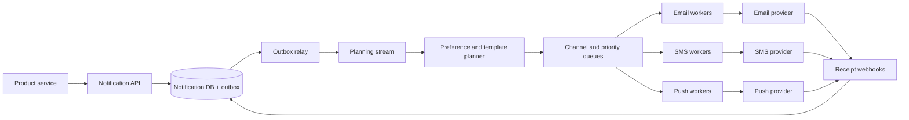

# Case study: design a notification platform

**Difficulty:** Intermediate

**Primary muscles:** asynchronous delivery, channel isolation, user preferences,
provider limits, retries, and observable delivery state.

## 1. Scope and requirements

Internal product services submit notifications for email, SMS, and mobile push.
The platform resolves templates and user preferences, delivers through external
providers, and records status.

Assume:

- 500 million channel deliveries per day, about 5,800 average deliveries/second
  and 60,000 at peak.
- Transactional notifications should start within five seconds.
- Bulk notifications may take minutes but must not delay transactional traffic.
- A single request may target several channels.
- Users can opt out by category and channel.
- Accepted requests must not be lost.
- Duplicate delivery should be rare, but external providers make a universal
  exactly-once guarantee impossible.
- Provider delivery receipts may arrive hours later and out of order.

Template editing, campaign audience selection, and provider procurement are
outside the core design. The platform accepts an already identified recipient,
not an unbounded audience query.

## 2. API and data model

```http
POST /v1/notifications
Idempotency-Key: order-123-shipped-v1

{
  "recipient_user_id": "user_42",
  "category": "order_updates",
  "template_id": "order_shipped",
  "template_parameters": {"order_id": "123"},
  "channels": ["push", "email"],
  "priority": "transactional",
  "send_after": null
}

GET /v1/notifications/{notification_id}
PUT /v1/users/{user_id}/notification-preferences
```

Core records:

```text
Notification(
  notification_id,
  tenant_id,
  idempotency_key,
  recipient_user_id,
  category,
  template_version,
  state,
  created_at
)

Delivery(
  notification_id,
  channel,
  destination_ref,
  provider,
  state,
  attempt_count,
  provider_message_id,
  next_attempt_at
)

Preference(user_id, category, channel, enabled, version)
ProviderEvent(provider, provider_event_id, delivery_id, status, occurred_at)
```

Use a unique `(tenant_id, idempotency_key)` constraint for submission and a
unique `(notification_id, channel)` constraint for planned deliveries.
Addresses and device tokens belong in a protected contact directory; events
carry references instead of copying sensitive destination data broadly.

## 3. High-level design



Separate queues and worker pools by channel and priority. A slow SMS provider
must not consume the resources needed for password-reset email or push.

## 4. Submission and planning

1. Authenticate the calling service and derive its tenant.
2. Validate the template parameters, recipient, channels, priority, and
   scheduling horizon.
3. In one transaction, create the notification, persist the idempotency result,
   and append an outbox event.
4. Return `202 Accepted` with the notification ID.
5. The planner loads the immutable template version and current preference
   snapshot.
6. It creates one delivery record per allowed channel and publishes work to the
   corresponding priority queue.
7. If all requested channels are suppressed, mark the notification accordingly
   rather than reporting a delivery failure.

Compliance categories need explicit rules. A security alert may be mandatory,
while marketing must honor opt-out and quiet-hour policy. Do not encode these
rules as scattered worker conditionals.

## 5. Channel delivery

Each channel worker:

1. Claims a delivery using a lease so abandoned work becomes available again.
2. Resolves the destination and renders the stored template version.
3. Applies tenant, recipient, and provider rate limits.
4. Sends a stable provider idempotency key when the provider supports one.
5. Records provider acceptance and message ID.
6. Retries only errors classified as transient, with bounded backoff and jitter.
7. Moves permanent failures to a terminal state with a reason.

Provider acceptance is not final user delivery. Webhooks or periodic status
queries update delivered, bounced, rejected, or expired state. Verify webhook
signatures and deduplicate by `provider_event_id`.

## 6. Ordering, retries, and duplicates

Most notifications do not need global order. Partition ordering-sensitive
categories by `(recipient_user_id, category)` and include a semantic version or
event time. Consumers can suppress a stale "order processing" notification that
arrives after "order shipped."

An ambiguous provider timeout is difficult: the provider may have accepted the
message even though the worker saw no response. Retry with the same provider
idempotency key if supported. Otherwise reconcile before retrying when duplicate
delivery is more harmful than delay. The platform cannot honestly guarantee
exactly once across every provider.

## 7. Scheduling and fairness

Store long-delay schedules in a durable time-indexed table or scheduling
service, not in worker memory. Move due items into channel queues in bounded
batches.

Use weighted fair scheduling across tenants and priority classes:

- Reserve capacity for urgent transactional work.
- Cap each tenant so a bulk campaign cannot monopolize a provider quota.
- Admit new bulk work only when queue-age objectives remain healthy.
- Track oldest item age, not just queue length.

## 8. Failures and operations

| Scenario | Behavior |
| --- | --- |
| One provider is unavailable | Open its circuit, retry with backoff, and use a preconfigured fallback only when duplicate and policy risks are acceptable. |
| Planning workers stop | Accepted requests remain in the durable stream; planning lag alerts before the five-second SLO is missed. |
| A worker crashes after provider acceptance | Lease expires; retry uses the same provider key or enters reconciliation. |
| A poison template repeatedly fails | Mark affected deliveries permanently failed and quarantine the template version instead of blocking a partition. |
| Push tokens become invalid | Mark the destination invalid from provider feedback and avoid future sends. |
| Preference service is unavailable | Use a recent versioned cache for low-risk transactional messages; fail closed for marketing. |
| One tenant sends a huge campaign | Tenant quotas and weighted queues preserve transactional capacity. |

Important metrics include submission errors, planning lag, oldest queue age,
attempt latency, provider acceptance rate, permanent failures by reason,
duplicate reports, and delivery-receipt delay.

## 9. Trade-offs and interviewer follow-ups

The design accepts asynchronous delivery to isolate callers from provider
latency. Durable state and outbox publication prevent accepted work from
disappearing, while separate queues protect channels and priorities. The cost is
eventual status, duplicate risk at provider boundaries, and a more involved
operational state machine.

Likely follow-ups:

- How would you send one campaign to 100 million users?
- How would quiet hours work across time zones?
- How would users see notification history across devices?
- How would you minimize sensitive data in logs and events?

Patterns used:

- [Queues, pub/sub, and logs](../patterns/messaging.md)
- [Transactional outbox](../patterns/outbox-and-cdc.md)
- [Idempotency](../patterns/idempotency.md)
- [Resilience patterns](../patterns/resilience.md)
- [Rate limiting](../patterns/rate-limiting.md)
- [Fan-out](../patterns/fan-out.md)
