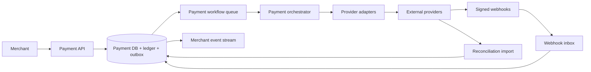

# Case study: design a payment processing service

**Difficulty:** Advanced

**Primary muscles:** idempotency, explicit state machines, immutable ledgers,
ambiguous provider outcomes, webhooks, and reconciliation.

## 1. Scope and requirements

Merchants create card payments through the service, authorize and capture funds
through external payment providers, issue refunds, and query status. The service
publishes payment events to merchant systems.

Assume:

- 50 million payment attempts per day, about 600 average attempts/second and
  6,000 at peak.
- Payment creation targets p99 under two seconds when the provider is healthy.
- No logical payment may be captured twice.
- Every balance-changing result must be auditable and reconcilable.
- A caller retry must return the original logical result.
- Provider callbacks can be delayed, duplicated, or out of order.
- A provider can time out after accepting an operation.
- Acknowledged internal records must survive an availability-zone failure.

Card collection and vaulting are delegated to a compliant tokenization provider.
The service stores payment-method tokens, not raw card numbers. Foreign
exchange, payouts, disputes, and the provider's internal settlement design are
outside the first pass.

The throughput is moderate compared with feed systems. Correctness and
operability, not early sharding, are the forcing constraints.

## 2. API and monetary model

```http
POST /v1/payments
Idempotency-Key: checkout-session-123

{
  "merchant_order_id": "order_123",
  "amount_minor": 2599,
  "currency": "USD",
  "payment_method_token": "pm_...",
  "capture_mode": "automatic"
}

GET  /v1/payments/{payment_id}
POST /v1/payments/{payment_id}/capture
POST /v1/payments/{payment_id}/refunds
```

Represent money as an integer in the currency's minor unit plus an explicit
currency. Never use binary floating point.

Core records:

```text
Payment(
  payment_id,
  merchant_id,
  merchant_order_id,
  amount_minor,
  currency,
  state,
  state_version,
  captured_amount,
  refunded_amount
)

PaymentAttempt(
  attempt_id,
  payment_id,
  operation,
  provider,
  provider_idempotency_key,
  provider_reference,
  state,
  last_error
)

LedgerTransaction(ledger_transaction_id, payment_id, type, created_at)
LedgerEntry(ledger_transaction_id, account_id, direction, amount_minor, currency)
ProviderEvent(provider, provider_event_id, payload_hash, processed_at)
OutboxEvent(event_id, aggregate_id, aggregate_version, type, payload)
```

Use unique constraints for `(merchant_id, idempotency_key)`, provider event IDs,
and provider idempotency keys. Every ledger transaction must balance debits and
credits in one database transaction.

## 3. Payment state machine

Use explicit permitted transitions rather than letting arbitrary callbacks
overwrite state:

```text
CREATED -> PROCESSING -> AUTHORIZED -> CAPTURED
                    |             \-> CANCELED
                    \-> FAILED

CAPTURED -> PARTIALLY_REFUNDED -> REFUNDED
```

Additional states such as `REQUIRES_ACTION` or `UNKNOWN` may be needed for
authentication and ambiguous provider outcomes. State versions make each
transition conditional and reject stale events.

Authorization reserves spending capacity but may not move settled money.
Create ledger transactions when the product recognizes a monetary movement,
such as capture, fee, refund, or settlement. Keep the authorization state
separate from accounting entries.

## 4. High-level design



The transactional database is the internal authority for payment state,
idempotency, ledger entries, and workflow intent. Provider adapters isolate
provider-specific contracts and error classification.

## 5. Create and authorize flow

1. Authenticate the merchant and validate amount, currency, order, and token.
2. Look up the merchant-scoped idempotency key.
3. In one transaction, create the payment, store the request hash and
   idempotency result, and append workflow intent to the outbox.
4. Create one provider attempt with a stable provider idempotency key derived
   from the internal `attempt_id`.
5. The orchestrator sends the authorization request with a strict deadline.
6. A definitive provider result enters the same transition path used by
   webhooks: deduplicate, validate, conditionally update state, and append an
   outbox event.
7. For automatic capture, perform capture as a distinct idempotent operation.
8. Return the known result, or `202 Processing` when provider status is not yet
   definitive.

Do not keep a database transaction open during the provider network call. The
durable attempt state is the bridge between local transactions.

## 6. Ambiguous outcomes

A timeout does not mean failure. The provider may have charged the card and
lost the response.

On timeout:

1. Keep the attempt in `UNKNOWN` or `PROCESSING`; do not mark it failed.
2. Query the provider by the stable idempotency key or provider reference.
3. If safe, retry the same operation with the same provider key.
4. Accept a later signed webhook through the deduplicated event path.
5. Escalate unresolved attempts to reconciliation or manual review.
6. Never start a new provider attempt merely because the first response was
   lost.

This is the central correctness discussion in a payment interview. Retries are
safe only when every layer recognizes the same logical operation.

## 7. Capture, refunds, and ledger

Capture uses a unique operation ID and a conditional transition from
`AUTHORIZED`. In one transaction:

- Confirm the remaining capturable amount.
- Record the successful provider result.
- Advance payment state and version.
- Insert balanced ledger entries.
- Append the merchant event to the outbox.

A refund is its own aggregate and provider attempt. Atomically reserve against
`captured_amount - refunded_amount` so concurrent refunds cannot exceed the
captured total. If the provider later rejects the refund, release the reservation
through an explicit state transition rather than deleting history.

Ledger entries are append-only. Correct mistakes with reversing entries. A
mutable balance can be maintained as a projection for fast reads, but it must be
rebuildable from the immutable journal.

## 8. Webhooks and reconciliation

Verify provider signatures against the raw request body, enforce a timestamp
window, and store each provider event ID before processing. Out-of-order events
must pass the payment state machine and state-version checks.

Reconciliation is not optional:

- Import provider transaction and settlement reports.
- Match by provider reference, amount, currency, and merchant.
- Detect internal success missing at the provider, provider success missing
  internally, amount mismatches, and duplicate provider operations.
- Route discrepancies to automated repair only when the correction is
  unambiguous; otherwise create a review case.

Track reconciliation age and unmatched money amount, not only record count.

## 9. Failures, security, and operations

| Scenario | Behavior |
| --- | --- |
| Client retries after losing the response | The merchant idempotency key returns the original payment and rejects a different request body. |
| Provider times out | Keep the attempt unresolved and query or retry with the same provider key. |
| Webhook arrives twice | The provider-event uniqueness constraint makes processing idempotent. |
| An old failure arrives after success | The state machine rejects the stale transition. |
| Workflow worker crashes after provider acceptance | Recovery resumes the durable attempt and reconciles by provider key. |
| Ledger insertion fails | The state transition and ledger transaction roll back together. |
| Primary provider is down | Route new attempts to a configured alternative only before an operation is ambiguous; never blindly replay unknown attempts elsewhere. |
| A region fails | Prefer temporary write unavailability over two active authorities unless a tested failover has a known replicated state position. |

Encrypt sensitive fields, use least-privilege service identities, isolate the
card-data environment, rotate webhook secrets, and keep immutable audit logs
for administrative actions.

## 10. Trade-offs and interviewer follow-ups

This design prefers a visible pending state over guessing after a timeout. A
single transactional authority makes invariants and ledger writes clear at the
cost of cross-region write latency or failover downtime. Asynchronous merchant
events decouple integrations but remain at-least-once.

Likely follow-ups:

- How would split tender or partial capture work?
- How would provider routing consider cost and success rate safely?
- How would payouts and settlement extend the ledger?
- How would you migrate a payment between provider API versions?

Patterns used:

- [Idempotency](../patterns/idempotency.md)
- [Saga](../patterns/saga.md)
- [Transactional outbox](../patterns/outbox-and-cdc.md)
- [Messaging](../patterns/messaging.md)
- [Resilience patterns](../patterns/resilience.md)
- [Replication](../patterns/replication.md)
