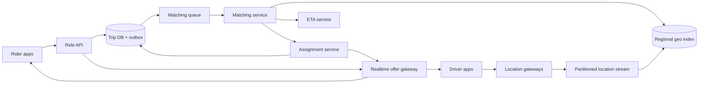

# Case study: design ride-hailing dispatch

**Difficulty:** Advanced

**Primary muscles:** high-rate location updates, geospatial indexing, realtime
matching, conditional assignment, leases, and regional ownership.

## 1. Scope and requirements

Drivers publish availability and location. A rider requests a trip, the system
finds nearby drivers, sends offers, assigns at most one driver, and tracks the
trip through completion.

Assume:

- 10 million completed trips per day, about 120 average trip starts/second and
  2,000 at peak.
- Up to 2 million drivers are online concurrently.
- Each online driver sends a location update every four seconds, producing
  about 500,000 location updates/second.
- Candidate search should use locations no more than ten seconds old.
- A rider should normally receive a match within five seconds.
- A driver must not be assigned to two active rides.
- Dispatch is regional; a trip does not cross an active-region boundary during
  matching.
- Temporary stale map display is acceptable, but trip and assignment state must
  be durable.

Routing algorithms, pricing, payments, fraud detection, and turn-by-turn
navigation are separate systems. An ETA service is treated as a dependency.

Location traffic dominates trip creation by more than two orders of magnitude.
That justifies separate ephemeral location infrastructure from the durable trip
database.

## 2. API and data model

Location updates normally use a streaming mobile protocol, shown here as a
logical contract:

```http
PUT  /v1/drivers/{driver_id}/location
POST /v1/ride-requests
GET  /v1/rides/{ride_id}
POST /v1/offers/{offer_id}/accept
POST /v1/rides/{ride_id}/arrive
POST /v1/rides/{ride_id}/start
POST /v1/rides/{ride_id}/complete
```

Core durable records:

```text
Ride(
  ride_id,
  rider_id,
  pickup,
  destination,
  region,
  state,
  driver_id,
  state_version
)

Offer(
  offer_id,
  ride_id,
  driver_id,
  expires_at,
  state,
  assignment_epoch
)

DriverAssignment(
  driver_id,
  status,
  current_ride_id,
  assignment_epoch,
  lease_until,
  version
)
```

Ephemeral geo entry:

```text
DriverLocation(driver_id, cell_id, latitude, longitude, heading, sequence, observed_at)
```

Persist the trip state machine and assignment authority. Keep only the latest
operational location in the geo index, with a TTL. Downsample selected location
history into cheaper storage for support, safety, and analytics according to
retention policy.

## 3. High-level design



The geo index answers fast candidate queries but is not the authority for
whether a driver is available. The assignment service and durable assignment
record decide that.

## 4. Location ingestion

1. Authenticate the driver session and derive the driver ID.
2. Reject impossible coordinates and apply per-device rate limits.
3. Partition updates by `driver_id` so one consumer observes each driver's
   sequence in order.
4. Drop an update with a sequence number older than the latest accepted update.
5. Map the coordinate to a geographic cell and update the driver's latest
   entry with a short TTL.
6. Publish a lower-frequency stream for durable history and analytics.

Use a hierarchical spatial index such as geohash, S2, or H3. The matching
service searches the pickup cell, then expands through neighboring rings until
it finds enough candidates or reaches a distance bound.

Dense downtown cells can become hot. Use smaller cells at high density,
partition a cell by driver hash, batch location updates, and query a bounded
set of subpartitions. Sparse rural areas use larger search rings.

## 5. Request and matching flow

1. The ride API validates pickup and destination, creates a `REQUESTED` ride,
   stores the idempotency result, and appends an outbox event.
2. A regional matcher reads the event and queries recent nearby geo entries.
3. It filters out stale locations and drivers whose durable assignment status
   is not available.
4. It requests ETA estimates for a bounded candidate set, scores candidates,
   and creates expiring offers for one driver or a small batch.
5. Offer notifications include a stable offer ID, ride summary, expiration,
   and assignment epoch.
6. If no one accepts, the matcher expands the radius or retries with the next
   candidates until a product timeout.

Sending to a small batch lowers rider wait but allows concurrent acceptances.
The assignment operation, not the offer, resolves the race.

## 6. Conditional assignment

When a driver accepts:

1. Validate the offer, driver identity, expiration, and ride state.
2. Atomically compare-and-set the driver from `AVAILABLE` to
   `RESERVED(ride_id)` and increment `assignment_epoch`.
3. Conditionally move the ride from `REQUESTED` or `MATCHING` to `MATCHED` with
   that driver.
4. Persist outbox events for the rider, winning driver, and cancellation of
   other offers.
5. If the ride transition loses a race, release the driver only if the
   reservation still contains the same ride and epoch.

The driver reservation is the safety boundary preventing double assignment.
The two records may be updated in one regional database transaction when
supported. If they cannot share a transaction, the durable workflow above is a
saga: a driver may be temporarily reserved without a matched ride, but the
lease and compensation restore availability. It favors safety over immediate
driver utilization.

The epoch acts as a fencing token. A delayed accept or stale matcher cannot
change an assignment after a newer epoch owns the driver.

## 7. Trip state and realtime updates

Use permitted versioned transitions:

```text
REQUESTED -> MATCHING -> MATCHED -> DRIVER_ARRIVING
          \-> CANCELED             -> IN_PROGRESS -> COMPLETED
```

Commands carry a ride version or idempotency key. Repeated "start trip" or
"complete trip" requests return the existing result. Outbox events notify
riders and drivers and feed downstream pricing, safety, and payment workflows.

Realtime gateways deliver offers and trip updates, but mobile clients always
recover state from the durable Ride API after reconnecting. A dropped socket
must not become a dropped assignment.

## 8. Regional partitioning

Route each city or operating region to a home region containing its trip store,
geo index, matching fleet, and assignment authority. Geographic cells near a
service boundary can be queried from both sides, but only one home region owns
the resulting ride.

Regional isolation:

- Keeps location and matching latency low.
- Prevents a global location index from becoming a coordination bottleneck.
- Limits a hot city from consuming every market's capacity.
- Supports data-residency policy.

Cross-region disaster recovery must avoid two assignment authorities for one
market. Promote a known replicated position with a new regional epoch, or pause
new matching until ownership is unambiguous.

## 9. Failures, overload, and privacy

| Scenario | Behavior |
| --- | --- |
| Location updates are delayed | Exclude entries older than the freshness bound and show reduced driver availability. |
| Two drivers accept together | Driver reservations may both succeed, but only one ride compare-and-set wins; release the loser by epoch. |
| A matcher crashes after creating offers | Durable offer expiration and ride state let another worker resume safely. |
| A driver app disconnects after accepting | Reservation remains durable; notify the rider and recover through the Ride API on reconnect. |
| ETA service is slow | Use a strict deadline and coarse distance ranking as an explicit degraded mode. |
| One city has a demand spike | Regional quotas, smaller geo cells, surge admission policy, and queue-age alerts isolate the hotspot. |
| Geo index fails | Stop new matching or use a recent replica; never infer availability solely from durable driver records with stale locations. |
| A stale worker sends commands | Assignment epochs fence changes from former owners. |

Driver location is sensitive. Encrypt it, restrict service access, minimize
retention, audit support access, and avoid exposing exact driver coordinates to
riders before product policy permits it.

## 10. Trade-offs and interviewer follow-ups

Separating ephemeral location from durable assignment lets the system absorb
500,000 updates/second without weakening trip invariants. Regional ownership
keeps matching fast but requires explicit failover. Small-batch offers improve
latency at the cost of reservation races handled by conditional writes and
compensation.

Likely follow-ups:

- How would scheduled rides differ from immediate dispatch?
- How would driver supply and rider demand affect matching fairness?
- How would trips crossing regional boundaries hand off live location?
- How would you prevent a driver from spoofing location?

Patterns used:

- [Partitioning](../patterns/partitioning.md)
- [Messaging](../patterns/messaging.md)
- [Idempotency](../patterns/idempotency.md)
- [Saga](../patterns/saga.md)
- [Transactional outbox](../patterns/outbox-and-cdc.md)
- [Leader election and fencing](../patterns/leader-election.md)
- [Resilience patterns](../patterns/resilience.md)
