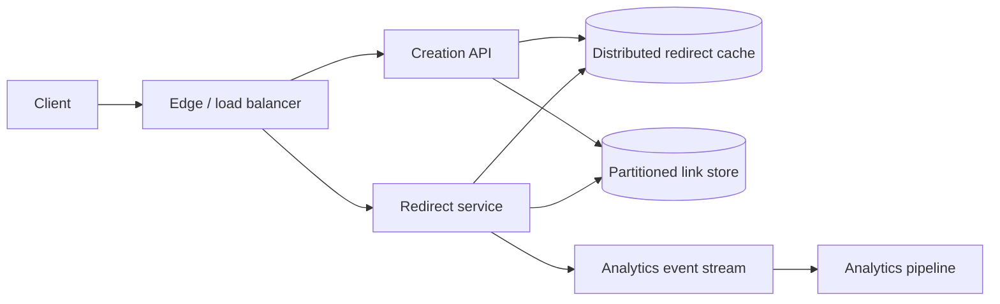

# Case study: design a URL shortener

**Difficulty:** Foundational

**Primary muscles:** key generation, read-heavy scaling, caching, expiration,
and abuse controls.

## 1. Scope and requirements

Users can create a short link for a valid destination URL and follow that link
to an HTTP redirect. Registered users may optionally request a custom alias and
set an expiration time.

Assume:

- 1 million new links per day, about 12 average writes/second and 120 at peak.
- 100 million redirects per day, about 1,200 average reads/second and 12,000 at
  peak.
- Links are retained for five years unless explicitly expired.
- Redirects target p99 under 100 ms.
- A newly created link must be immediately usable.
- Redirect availability matters more than analytics freshness.
- Click analytics may lag by several minutes and may lose a small number of
  events during a severe outage.

At roughly 1.8 billion links over five years and 500 bytes of metadata per link,
raw metadata approaches 1 TB before indexes and replicas. The 100-to-1
read/write ratio makes caching useful, but the write rate does not justify a
complex distributed ID service by itself.

## 2. API and data model

```http
POST /v1/links
Idempotency-Key: 01J...

{
  "destination_url": "https://example.com/a/long/path",
  "custom_alias": null,
  "expires_at": "2027-08-25T00:00:00Z"
}

GET /{code}
GET /v1/links/{code}
DELETE /v1/links/{code}
```

Core record:

```text
ShortLink(
  code,
  destination_url,
  owner_id,
  created_at,
  expires_at,
  status,
  version
)
```

`code` is the primary key. An owner index supports management queries, but
redirects remain a single key lookup. Store analytics separately so high click
volume never updates the link row.

## 3. Code generation

Generate an eight-character random base62 code and insert it with a uniqueness
constraint. There are about 218 trillion possible values (`62^8`). On a
collision, generate another code and retry a small bounded number of times.

This choice:

- Avoids a globally coordinated sequence.
- Does not reveal creation volume through sequential IDs.
- Distributes keys more evenly than a timestamp prefix.
- Makes the database uniqueness constraint the collision authority.

Custom aliases use the same conditional insert. Normalize only documented
properties, such as case sensitivity, before the uniqueness check. Reserve
system paths such as `/v1`, `/admin`, and health endpoints.

## 4. High-level design



The redirect path is intentionally short. TLS termination, coarse abuse
controls, and optional caching of popular redirects can also happen at the
edge.

## 5. Create path

1. Authenticate the caller if account ownership is requested.
2. Validate URL length and allow only supported schemes such as HTTPS and HTTP.
3. Check the idempotency key. The key and request hash prevent a client retry
   from creating a second short link.
4. Generate a code or validate the requested custom alias.
5. Insert the link and idempotency result in one transaction.
6. Fill the redirect cache after commit, or let the first redirect populate it.
7. Return the canonical short URL.

If cache population fails, creation still succeeds because the link store is
authoritative. The first redirect must use a read path that observes the
committed write; it should not be routed to a lagging replica immediately after
creation.

## 6. Redirect path

1. Validate the code format at the edge.
2. Look up the code in a local or distributed cache.
3. On a miss, read the authoritative link record.
4. Reject disabled or expired links.
5. Cache a valid destination with a TTL no later than the link expiration.
6. Return `302 Found` by default so destination changes remain possible. Use a
   permanent redirect only if product semantics make the mapping immutable.
7. Emit click analytics asynchronously without blocking the redirect.

Briefly negative-cache unknown codes to protect the database from random scans.
Invalidate that negative entry when a custom alias with the same code is later
created.

## 7. Partitioning and caching

Partition the link store by a hash of `code`. This evenly distributes lookups
and creation writes. Replicate each partition across availability zones.

A viral code can become a hot key even though data is evenly partitioned.
Mitigations include:

- Edge caching for public redirects.
- Per-instance in-memory caching in front of the distributed cache.
- Replicating one tiny immutable value across cache nodes.
- Request coalescing when a popular key expires.
- TTL jitter to avoid synchronized expiry.

Cache disabled-link state for only as long as the product can tolerate delayed
takedown, or push invalidation events to the edge for urgent abuse response.

## 8. Failures and abuse

| Scenario | Behavior |
| --- | --- |
| Redirect cache is unavailable | Bound origin concurrency and read the replicated link store; shed analytics first. |
| Link-store leader fails | Promote a replica; temporary creation errors are acceptable, but existing cached redirects continue. |
| Creation response is lost | Client retries with the same idempotency key and receives the original code. |
| One code becomes viral | Edge and local caches absorb the hot key without concentrating reads on one database partition. |
| Analytics pipeline is behind | Redirects continue; queue age alerts and consumers catch up within retention. |
| A malicious destination is reported | Disable the record and push cache invalidation; keep an audit trail. |
| Random-code scans spike | Format checks, IP or principal limits, negative caching, and abuse detection reduce origin load. |

Do not fetch destination URLs during redirect, which would create an SSRF path.
If a separate safety scanner fetches them, isolate it from private networks and
apply strict egress policy.

## 9. Trade-offs and interviewer follow-ups

Random IDs exchange rare collision retries for simplicity and write
distribution. Caching lowers latency but makes takedown propagation a product
decision. The system favors redirect availability; link creation can fail
closed when uniqueness cannot be guaranteed.

Likely follow-ups:

- How would globally unique custom aliases work across regions?
- How would you support destination edits without stale permanent redirects?
- How would analytics count unique visitors without storing raw IP addresses?
- When would a relational store stop being sufficient?

Patterns used:

- [Load balancing and edge delivery](../patterns/traffic-management.md)
- [Caching](../patterns/caching.md)
- [Replication](../patterns/replication.md)
- [Partitioning](../patterns/partitioning.md)
- [Rate limiting](../patterns/rate-limiting.md)
- [Idempotency](../patterns/idempotency.md)
