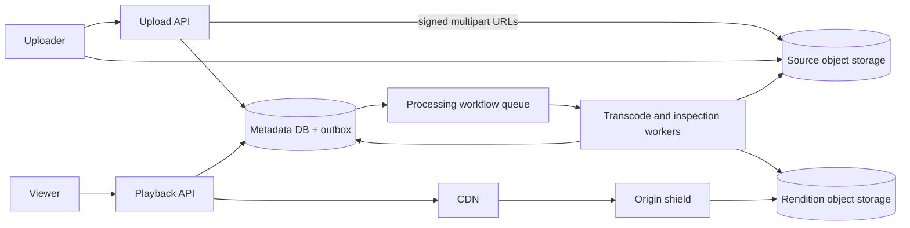

# Case study: design video upload and streaming

**Difficulty:** Advanced

**Primary muscles:** direct object upload, durable processing workflows,
adaptive streaming, CDN delivery, and cost-aware failure handling.

## 1. Scope and requirements

Users upload prerecorded videos and viewers stream published videos on web and
mobile clients. The platform creates multiple resolutions, thumbnails, and an
adaptive streaming manifest.

Assume:

- 100,000 uploads per day with an average 1 GB source, or about 100 TB of new
  source media per day.
- 100 million playback sessions per day.
- Average viewing is five minutes at 3 Mbps, producing roughly 11 PB of daily
  playback egress before caching.
- Playback should start within two seconds at p99 on a healthy network.
- Uploads resume after interruption.
- Acknowledged source media must survive an availability-zone failure.
- Most videos should become playable within ten minutes.
- Metadata may be strongly consistent; processing status and CDN propagation
  are eventually consistent.

Live streaming, recommendations, comments, advertising, and a full rights
management system are outside the initial design.

The egress estimate makes CDN delivery mandatory. Even a 95% cache hit ratio
leaves hundreds of terabytes per day reaching an origin tier, so origin
shielding and immutable segments still matter.

## 2. API and data model

```http
POST /v1/videos/uploads
POST /v1/videos/{video_id}/uploads/{upload_id}/complete
GET  /v1/videos/{video_id}
GET  /v1/videos/{video_id}/playback
DELETE /v1/videos/{video_id}
```

The first call returns a video ID and short-lived signed URLs for multipart
upload directly to object storage.

Core records:

```text
Video(video_id, owner_id, title, visibility, state, source_version, created_at)
Upload(upload_id, video_id, expected_parts, checksum, state, expires_at)
Rendition(video_id, source_version, profile, state, object_prefix, checksum)
ProcessingStep(video_id, source_version, step, attempt, state, lease_until)
```

Use immutable object keys such as:

```text
sources/{video_id}/{source_version}/original
renditions/{video_id}/{source_version}/{profile}/{segment_number}
manifests/{video_id}/{source_version}/master.m3u8
```

Versioned keys avoid overwriting content already cached around the world.

## 3. High-level design



Application servers handle control-plane metadata, not video bytes. Uploaders
and viewers transfer media directly through object storage and the CDN.

## 4. Upload flow

1. Authenticate the uploader, enforce quota, and create an idempotent upload
   session.
2. Return signed multipart URLs constrained to one object key, content length,
   part count, and short expiration.
3. The client uploads parts directly and retries failed parts.
4. On completion, the API verifies the object exists, expected parts are
   present, and the checksum or storage integrity metadata matches.
5. In one transaction, change the video from `UPLOADING` to `PROCESSING` and
   append an outbox event.
6. A lifecycle rule deletes abandoned multipart uploads and quarantined source
   objects after their retention period.

Untrusted media lands in a private quarantine bucket. Validate container,
codec, duration, and file structure before any content is served from a public
origin.

## 5. Processing workflow

Model processing as a durable directed workflow:

1. Probe media metadata and reject unsupported or dangerous files.
2. Run policy checks such as malware scanning and content moderation.
3. Decode the source and create an encoding ladder for supported resolutions
   and bitrates.
4. Segment each rendition for HLS or DASH.
5. Generate thumbnails and captions when available.
6. Write a master manifest only after the minimum playable rendition set is
   complete.
7. Atomically publish the manifest version in metadata.

Workers are stateless and claim steps with leases. Every output path is
deterministic by video, source version, and profile, so a retry overwrites or
verifies the same immutable result instead of creating duplicates. Record
checksums before declaring a step complete.

Split very large videos into chunk-level jobs, but cap parallelism per video so
one upload cannot consume the fleet. Priority queues can reserve capacity for
short or premium uploads while preserving tenant fairness.

## 6. Playback flow

1. The playback API authenticates the viewer and checks visibility, geography,
   and publication state.
2. It returns a short-lived signed manifest URL or token.
3. The player downloads the manifest through the CDN.
4. Adaptive bitrate logic selects segments based on measured bandwidth and
   buffer health.
5. CDN points of presence serve cached immutable segments; misses go through an
   origin shield to object storage.

The playback API is not called for every segment. Authorization tokens should
cover a bounded playback session without exposing an indefinitely shareable
origin URL.

Popular new releases can miss in many edge locations at once. Origin shielding,
request coalescing, and prewarming selected regions prevent a cache-fill storm.

## 7. Publication, deletion, and consistency

Metadata moves through an explicit state machine:

```text
UPLOADING -> PROCESSING -> READY -> PUBLISHED
                         -> FAILED
PUBLISHED -> BLOCKED or DELETED
```

The manifest pointer is published only after referenced objects are durable.
Optional higher renditions can appear in a later manifest version.

Deletion first blocks authorization and issues urgent CDN invalidation, then
deletes derived and source objects asynchronously according to legal retention.
Because invalidation is not instantaneous, sensitive takedown requirements may
need short token lifetimes in addition to cache control.

## 8. Failures and cost controls

| Scenario | Behavior |
| --- | --- |
| An upload connection drops | Multipart state lets the client resume only missing parts. |
| A worker crashes mid-transcode | Its lease expires; a retry writes to the same deterministic output key. |
| One media file always crashes a codec | Bound attempts, quarantine the source, mark processing failed, and alert on the codec signature. |
| The processing queue grows | Autoscale from oldest-job age, apply upload admission control, and preserve priority fairness. |
| A CDN region misses a viral video | Origin shield and request coalescing protect object storage. |
| Metadata is ready before objects replicate | Publication waits for durable object confirmation in required zones. |
| A source version is replaced | New renditions use a new versioned prefix; old manifests remain coherent until retired. |

Major cost levers are encoding ladder width, storage replication, source-media
retention, CDN hit ratio, egress contracts, and cold-storage transition. Track
cost per uploaded minute and delivered viewing hour, not only infrastructure
totals.

## 9. Trade-offs and interviewer follow-ups

Direct object transfer keeps media bytes away from application servers. A
durable asynchronous workflow tolerates long processing but creates eventual
publication and operational state. Immutable, versioned segments make CDN
behavior predictable at the cost of cleanup and duplicate storage during
replacement.

Likely follow-ups:

- How would live streaming differ?
- How would uploads continue across regions?
- How would digital rights management affect playback?
- How would you optimize processing for a video that suddenly becomes urgent?

Patterns used:

- [Load balancing and edge delivery](../patterns/traffic-management.md)
- [Messaging](../patterns/messaging.md)
- [Idempotency](../patterns/idempotency.md)
- [Resilience patterns](../patterns/resilience.md)
- [Transactional outbox](../patterns/outbox-and-cdc.md)
- [Leader election and fencing](../patterns/leader-election.md)
