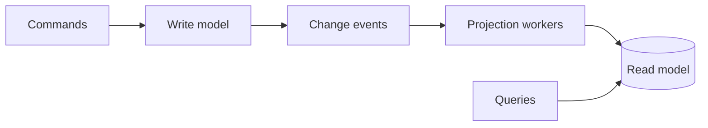

# CQRS and event sourcing

These patterns are related but independent. Do not introduce either only
because the system has reads and writes.

## CQRS

Command Query Responsibility Segregation uses different models for writes and
reads. A normalized transactional model can enforce invariants while one or
more denormalized projections serve specific queries.

Use CQRS when query shape, scale, or latency differs substantially from the
write model. Costs include eventual consistency, duplicate storage, projection
rebuilds, and more operational surfaces.

## Event sourcing

Event sourcing stores an append-only sequence of domain events as the source of
truth. Current state is obtained by replaying events, usually from a snapshot
plus newer events.

It is useful when history, auditability, temporal queries, or domain behavior
from event sequences is central. It is not a default replacement for CRUD.

An event-sourced aggregate needs:

- An immutable stream ID and monotonically increasing version.
- Optimistic concurrency when appending the next event.
- Stable event IDs, types, timestamps, and schema versions.
- Deterministic state reconstruction.
- Snapshots for long streams.
- Upcasters or migration logic for old event schemas.
- A strategy for sensitive-data deletion, which conflicts with immutable
  history and must be designed early.

## Failure modes

- A projection can lag, fail, or contain a bug. Keep checkpoints and support a
  versioned rebuild into a new index or table.
- Replaying side effects such as emails is dangerous. Separate state-building
  events from effect execution.
- Event contracts become permanent history. Renaming a field in current code
  does not rewrite old events.
- Debugging requires correlating command handling, event append, and projection
  state.
- Dual writes reappear if the event store and broker are updated independently.

## Interview cues

Use CQRS to justify a specialized read model, such as a feed or search index.
Use event sourcing only when immutable business history itself is valuable.
State the expected projection lag and rebuild procedure.

**Sound bite:** "CQRS separates models for different access patterns; event
sourcing changes the source of truth to an event history. Either can exist
without the other."
