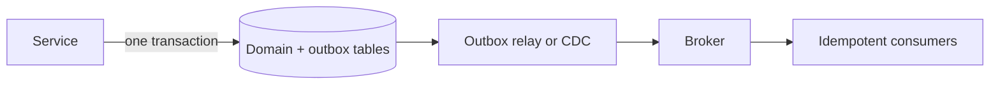

# Transactional outbox and change data capture

**Use when:** a committed database change must reliably cause an event or update
another system.

## The dual-write problem

Writing domain data and publishing an event in separate operations has an
unavoidable crash window:

```text
write database -> crash -> event never published
publish event   -> crash -> database write never commits
```

Retrying either order can also produce duplicates. A distributed transaction is
often unavailable or too costly across the database and broker.

## Transactional outbox

Write the domain row and an outbox row in one local database transaction. A
relay later publishes the outbox row to the broker.



Typical outbox fields are event ID, aggregate ID, aggregate version, event type,
schema version, payload, creation time, and publication state if polling.

The relay can:

- Poll unpublished rows, publish them, then mark or delete them.
- Tail the database transaction log with CDC and map outbox inserts to events.

Both approaches normally provide at-least-once delivery. A crash after publish
but before marking completion causes a duplicate, so consumers remain
idempotent.

## CDC without an outbox

CDC can stream ordinary table changes from a database log into a broker,
search index, cache, or warehouse. It avoids application dual writes and
captures changes from multiple writers.

Raw row changes are coupled to the storage schema and may not express domain
intent. An outbox provides an explicit event contract; direct CDC is useful for
derived views and data integration where row-level changes are appropriate.

## Ordering and lifecycle

- Partition by aggregate ID to preserve per-aggregate event order.
- Include aggregate versions so consumers can reject stale updates or detect a
  gap.
- Monitor source-log retention, relay lag, publish failures, and consumer lag.
- Retain enough log history to survive the longest expected outage.
- Archive or delete processed outbox rows without racing the relay.
- Define snapshot/bootstrap behavior for a new consumer, then continue from a
  known log position.

## Interview cues

Use this pattern whenever a design says "save the row and send a message."
Explain the local transaction, relay checkpoint, duplicate window, consumer
idempotency, and recovery from lost checkpoints.

See the repository's [CDC lab](../../labs/change-data-capture/README.md) for a
PostgreSQL to Kafka to Elasticsearch example.

**Sound bite:** "The database commit is the source of truth; the outbox makes
event intent part of that commit, and at-least-once relay plus idempotent
consumers closes the crash window."
