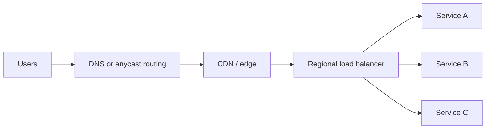

# Load balancing and edge delivery

**Use when:** traffic exceeds one instance, instances fail independently, or
users need low latency across regions.

## Core idea

Route requests across a pool of replaceable service instances. Move cacheable
content and connection termination closer to users when geography matters.

## Decisions to make

- **Layer 4 vs. layer 7:** L4 routes connections using transport information.
  L7 understands HTTP attributes and can route by host, path, header, or cookie.
- **Algorithm:** round robin is simple; least-connections helps uneven request
  durations; weighted routing supports heterogeneous instances and canaries.
- **Health:** distinguish process liveness from readiness to serve traffic.
  Remove unhealthy targets gradually enough to avoid oscillation.
- **Session state:** prefer external state. Sticky sessions reduce flexibility
  and can create uneven load, but may be necessary for some connection types.
- **Global routing:** DNS, anycast, or a global proxy can route by latency,
  health, policy, and data residency.
- **Edge behavior:** cache static and safely cacheable dynamic responses,
  terminate TLS, filter abuse, and enforce coarse limits.

## Trade-offs and failure modes

- A load balancer is part of the critical path and needs redundant instances.
- Health checks can pass while a dependency is failing, or fail during a
  temporary pause and unnecessarily drain capacity.
- Connection draining is required during deployment so in-flight work is not
  cut off.
- A regional failover may overload the surviving region; reserve capacity and
  test failover rather than assuming it.
- CDN invalidation is not instantaneous. Versioned object URLs are safer for
  immutable assets.
- Cache keys must include all dimensions that change a response, especially
  tenant, authorization, language, and content encoding.

## Interview cues

Mention load balancing after making the service stateless. Explain how targets
are discovered, how health changes routing, and where TLS terminates. For global
systems, state whether writes remain in a home region or can occur anywhere.
**Sound bite:** "The balancer spreads load, but health checks, draining, and
regional capacity determine whether it also improves availability."
