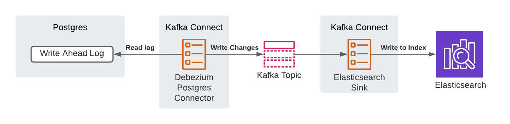

# Change data capture lab

This lab demonstrates the
[change data capture pattern](../../docs/patterns/outbox-and-cdc.md) by
building an eventually consistent Elasticsearch read model from PostgreSQL.

This is a local-only lab, not a remote deployment. Its demonstration credentials
and disabled Elasticsearch authentication are not production security. All
published ports bind to `127.0.0.1`; localhost URLs and internal service
connections are unchanged.

## What you will learn

- How PostgreSQL's write-ahead log becomes an ordered change stream.
- How Debezium checkpoints its position and resumes after a restart.
- Why Kafka and Elasticsearch delivery is at-least-once.
- Why a derived read model needs lag monitoring, idempotency, and a rebuild
  strategy.

## Architecture

PostgreSQL is the system of record. Debezium tails its logical replication log
and publishes row changes to Kafka. An Elasticsearch sink consumes those
changes and maintains a search-oriented projection.



```text
PostgreSQL WAL -> Debezium source connector -> Kafka users topic
                                                 |
                                                 v
                                     Elasticsearch sink -> users index
```

This avoids synchronous dual writes from application code. PostgreSQL can
commit even when Elasticsearch is temporarily unavailable; the projection
catches up from the retained log.

## Run the lab

Prerequisites: Docker with Compose support, `curl`, and enough memory for
PostgreSQL, Kafka, Kafka Connect, and Elasticsearch.

1. Build and start the services:

   ```bash
   docker compose up --build -d
   ```

2. Wait until Kafka Connect and Elasticsearch respond:

   ```bash
   curl --fail http://localhost:8083/connectors
   curl --fail http://localhost:9200
   ```

3. Run the requests in
   [`debezium-jdbc-es/create_connector.md`](debezium-jdbc-es/create_connector.md)
   in order. They create the Elasticsearch index, Debezium source connector,
   and Elasticsearch sink connector.

4. Verify the initial five PostgreSQL users reached the projection:

   ```bash
   curl --fail 'http://localhost:9200/users/_search?pretty'
   ```

5. Insert another user into PostgreSQL:

   ```bash
   docker compose exec postgres \
     psql --username postgres --dbname test_db \
     --command "INSERT INTO users(email) VALUES ('study_guide@test.com');"
   ```

6. Query Elasticsearch again and observe the new document:

   ```bash
   curl --fail 'http://localhost:9200/users/_search?pretty'
   ```

7. Stop the lab and remove its volumes:

   ```bash
   docker compose down --volumes
   ```

## Guarantees and failure drills

| Scenario | Expected behavior |
| --- | --- |
| Elasticsearch is unavailable | Kafka retains events; the sink accumulates lag and catches up after recovery. |
| Kafka Connect restarts | Connector offsets let processing resume from a checkpoint. |
| An event is delivered twice | The document key allows the sink to overwrite the same projection entry. |
| PostgreSQL changes while the sink is down | The system of record remains available, subject to Kafka retention and WAL capacity. |
| A new projection is added | It needs a consistent initial snapshot followed by changes from the corresponding log position. |

Try stopping Elasticsearch, inserting rows, restarting it, and measuring how
long the projection takes to converge. Then inspect connector status:

```bash
curl --fail http://localhost:8083/connectors/users-connector/status
curl --fail http://localhost:8083/connectors/es-sink-users/status
```

## Interview takeaways

- CDC is a good fit for search indexes, caches, analytics, and integrations that
  can tolerate asynchronous propagation.
- Elasticsearch remains a derived view, not the authority for writes.
- A source log preserves database commit order, but downstream ordering depends
  on topic partitioning and consumer behavior.
- Connector checkpoints prevent most loss, but crashes around acknowledgment
  can still cause duplicate delivery.
- Production designs pin image versions, secure every connection, monitor WAL
  and consumer lag, define schema compatibility, and test full rebuilds.

## References

- [Debezium PostgreSQL connector](https://debezium.io/documentation/reference/stable/connectors/postgresql.html)
- [Debezium examples](https://github.com/debezium/debezium-examples)
- [Kafka Connect concepts](https://kafka.apache.org/documentation/#connect)
